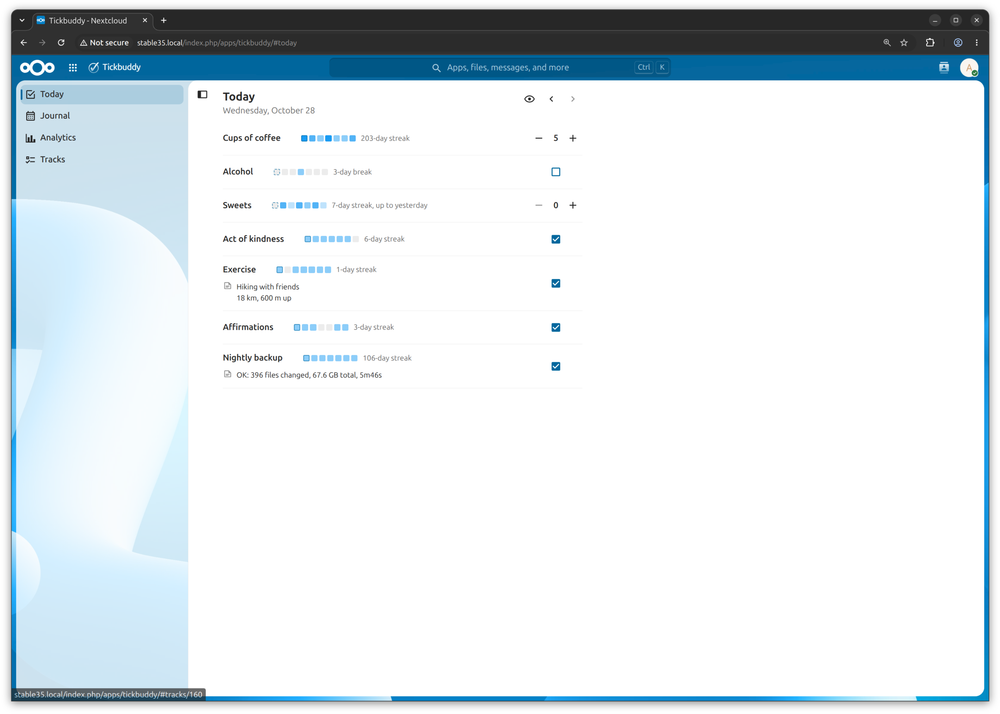
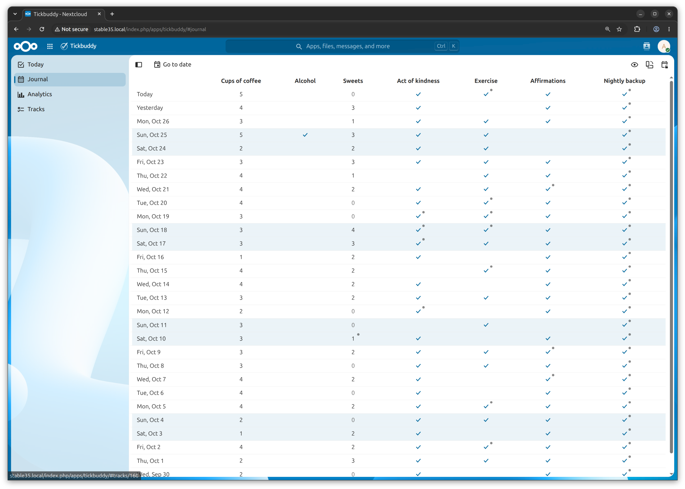
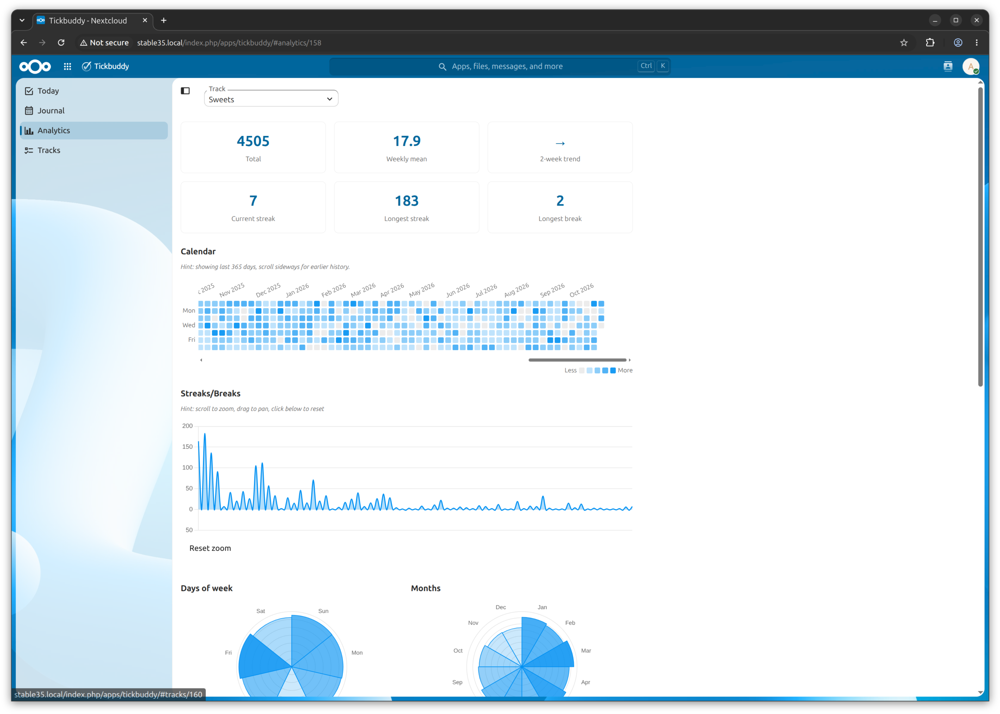
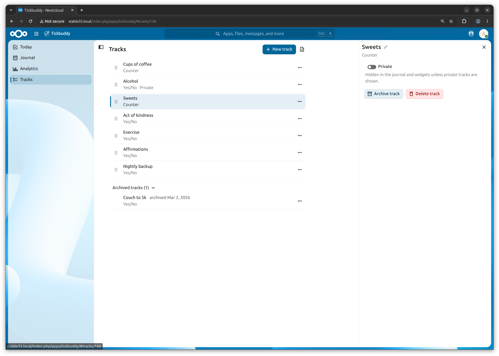
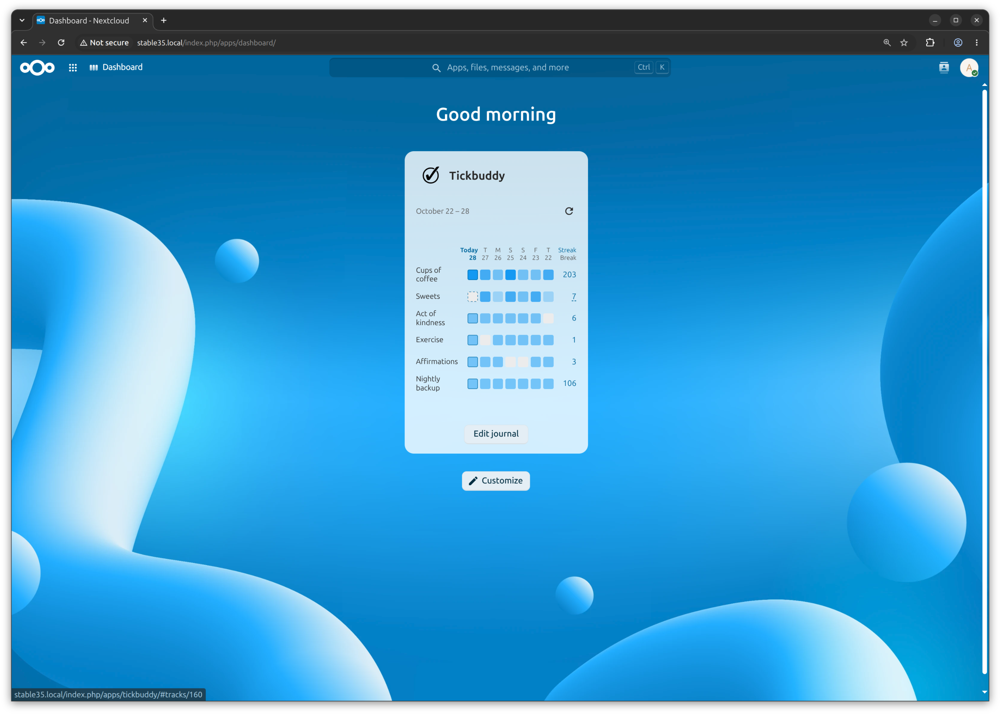

# Tickbuddy

Tickbuddy is a daily habit and event tracker for Nextcloud.

Tickbuddy lets you keep track of what happens each day, such as your meditation, exercise, or how many cups of coffee you had. Your scripts and AI agents can also log automatically, for example to record nightly backups. Tickbuddy is flexible: use it for habits, chores, keeping an eye on automations, or anything else that matters to you. Over time, analyse patterns and statistics with the built-in analytics.

Tickbuddy is published on the [Nextcloud app store](https://apps.nextcloud.com/apps/tickbuddy) and comes with a rich set of companion apps: 
- [Tickdroid](https://github.com/martinhammer/tickdroid), the Android app, available on [F-Droid](https://f-droid.org/packages/com.martinhammer.tickdroid/)
- [Tickcli](https://github.com/martinhammer/tickcli), a command-line client for your scripts and automations
- [TickLLMe](https://github.com/martinhammer/tickllme), an MCP server that lets your AI agents log and read your entries

### Features

Some of the key features which already exist:
* Today screen to tick each track for one day, with the last seven days, the current streak and the day's note
* Journal screen in two layouts (days down or tracks down), with a choice of which days can be changed, notes in the cells, and "Go to date"
* Tracks screen to add, rename, reorder, archive, restore and delete tracks (i.e. events to be tracked), and to import and export
* Short freetext notes on any track's day
* Analytics screen with stats and various visualizations
* Nextcloud dashboard widget
* Import/export data in JSON format
* Import data from Tickmate backup file
* A rich set of APIs leveraged by companion apps: [Tickdroid](https://github.com/martinhammer/tickdroid), [Tickcli](https://github.com/martinhammer/tickcli), [TickLLMe](https://github.com/martinhammer/tickllme)

Planned features:
* Ping URLs for further automation integrations
* Additional track types
* Setting and tracking of targets, goals and expectations 
* UI enhancements to track management, logging, and analytics
* Migration options from other tools
* Support for translations and accessibility
* Maybe even a smartwatch app

### Motivation
Tickbuddy started as a habit tracker for Nextcloud, motivated by the lack of such an app in the Nextcloud ecosystem. Whilst habit tracking is still the major use case, it has been evolving towards a more flexible "daily everything-tracker" concept which supports many use cases beyond its original scope, in particular via integration with automations and AI agents.

The original inspiration for Tickbuddy and Tickdroid was the "one-bit journal" Android app [Tickmate](https://f-droid.org/en/packages/de.smasi.tickmate/).

This is a personal hobby project. Significant portion of the code has been written by Claude Code.

### Found a bug? Do you have some suggestions or a feature request?

Feel free to get in touch and/or submit an issue.

### Screenshots

Today screen

Journal screen

Analytics screen

Tracks screen

Dashboard Widget

